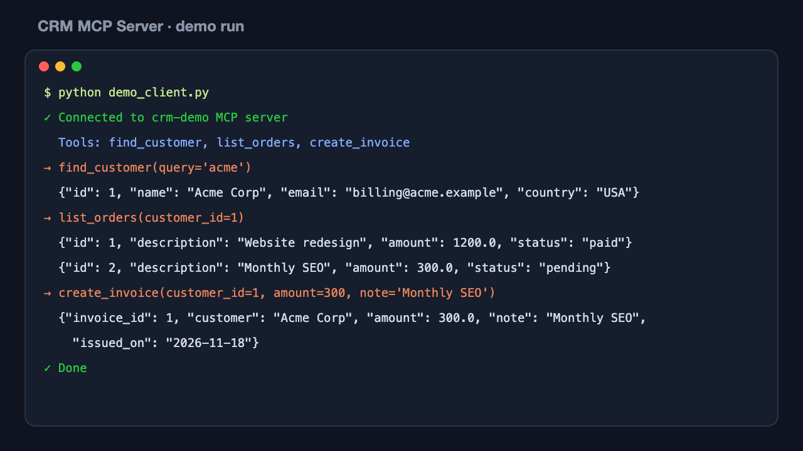

# CRM MCP Server for Claude

A small, production-style [Model Context Protocol](https://modelcontextprotocol.io) server that lets Claude work with business data in plain English: search customers, read their orders and create invoices.

> "Find Acme Corp, check their pending orders and invoice them $300 for Monthly SEO."
>
> Claude calls `find_customer` → `list_orders` → `create_invoice` and replies: *"Done. Invoice #1 for $300 has been created for Acme Corp."*



## Tools

| Tool | What it does |
|---|---|
| `find_customer(query)` | Search customers by part of their name or email |
| `list_orders(customer_id)` | List all orders for a customer |
| `create_invoice(customer_id, amount, note)` | Create an invoice, with input validation |

Data is stored in SQLite (`crm.db`, created and seeded automatically on first run). Swap `crm.py` for your own database, API or CRM and the server works the same way.

## Quick start

Requires Python 3.10+.

```bash
git clone https://github.com/longdang2072/mcp-crm-demo.git
cd mcp-crm-demo
python -m venv .venv && source .venv/bin/activate
pip install -r requirements.txt
pytest                  # 4 tests should pass
python demo_client.py   # calls every tool, like the demo above
```

### Use with Claude Code

```bash
claude mcp add crm-demo -- /absolute/path/to/mcp-crm-demo/.venv/bin/python /absolute/path/to/mcp-crm-demo/server.py
```

Then start `claude` and ask: *"Which customers do we have in Vietnam?"*

### Use with Claude Desktop

Add this to `claude_desktop_config.json` (macOS: `~/Library/Application Support/Claude/`, Windows: `%APPDATA%\Claude\`) and restart Claude Desktop:

```json
{
  "mcpServers": {
    "crm-demo": {
      "command": "/absolute/path/to/mcp-crm-demo/.venv/bin/python",
      "args": ["/absolute/path/to/mcp-crm-demo/server.py"]
    }
  }
}
```

### Run with Docker

```bash
docker build -t mcp-crm-demo .
docker run -i --rm mcp-crm-demo
```

## Project structure

```
crm.py          business logic and SQLite storage (testable without MCP)
server.py       MCP server exposing the tools to Claude
test_crm.py     unit tests
Dockerfile      container image
```

## Need this for your business?

I build custom MCP servers and AI agents that connect Claude to your own APIs, databases and internal tools.
Hire me on Fiverr: [fiverr.com/longdh01](https://www.fiverr.com/longdh01)
